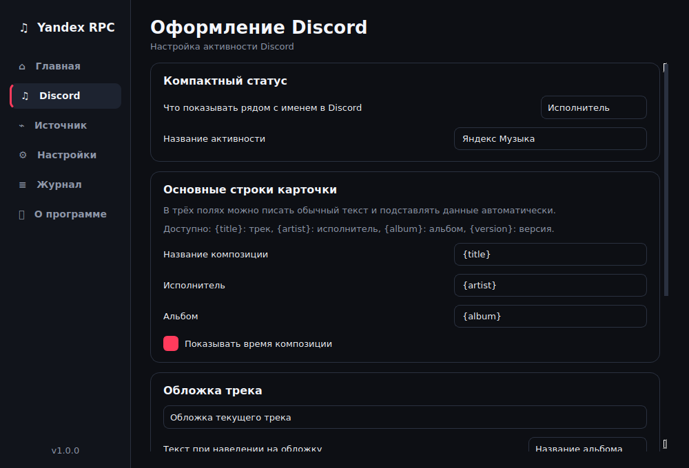

# Yandex Music RPC

Discord Rich Presence для настольной Яндекс Музыки на Windows.

[Релизы](https://github.com/Arbuz1kSM/YandexMusicRPC/releases) · [Сообщить об ошибке](https://github.com/Arbuz1kSM/YandexMusicRPC/issues) · [Telegram](https://t.me/Arbuz1k_TG)



## Возможности

- Название трека, исполнитель, альбом и обложка в активности Discord.
- Подсказка обложки с альбомом, названием трека, исполнителем или своим текстом.
- Кликабельные название и исполнитель, кнопка «Открыть в ЯМузыке».
- Независимое включение ссылок в тексте, кнопки трека и кнопки GitHub.
- Настройка строк карточки через шаблоны.
- Отображение времени композиции и настройка поведения при паузе.
- Работа в трее, запуск вместе с Windows, русский и английский интерфейс.
- Несколько цветовых тем.

## Установка

1. Скачайте `YandexMusicRPC-1.0.0-Setup.exe` из релиза и установите приложение.
2. Запустите Discord Desktop и настольную Яндекс Музыку.
3. Включите музыку. Приложение подключится к Discord автоматически.

Система: Windows 10/11 x64. Python для готовой сборки устанавливать не нужно.

Перед обновлением закройте приложение через пункт «Выход» в трее.

## Источник данных

Windows Media Control определяет трек, позицию и состояние воспроизведения. API Яндекс Музыки уточняет альбом, версию композиции, обложку и ссылки.

По умолчанию используется режим «Windows + Яндекс Музыка». Приложение сначала пробует получить метаданные без входа. Если данные не находятся, авторизуйтесь на вкладке «Источник». Токен сохраняется в Windows Credential Manager.

В режиме «Только Windows» запросы к API не отправляются. Внешняя обложка и ссылки на музыку в этом режиме обычно недоступны. Если API перестал отвечать, приложение продолжит показывать данные Windows.

## Настройка Discord

Активность Discord всегда использует тип «Слушает», в том числе при обновлении со старых версий. Переключателя типа активности нет.

В разделе ссылок есть общий выключатель и отдельные галочки для текста и кнопки. Их можно включить одновременно. Название и кнопка открывают текущий трек; строка исполнителя открывает первого исполнителя. Кнопка GitHub настраивается отдельно.

Для текста обложки можно выбрать альбом, трек, исполнителя, свой шаблон или отсутствие текста. Шаблон «Альбом» используется для текста обложки и компактного статуса.

Шаблоны поддерживают переменные:

| Переменная | Значение |
| --- | --- |
| `{title}` | Название трека |
| `{artist}` | Исполнитель |
| `{album}` | Альбом |
| `{version}` | Версия композиции |
| `{time}` | Текущее время |
| `{date}` | Текущая дата |
| `{volume}` | Громкость Windows |
| `{session_time}` | Время прослушивания за текущий запуск |

Оба поля «Название активности» редактируют одну настройку. На вкладке Discord она применяется после завершения редактирования; на вкладке «Источник» сохраняется вместе с Application ID.

## Запуск из исходников

Нужны Windows и Python 3.12.

```powershell
py -3.12 -m venv .venv
.\.venv\Scripts\python.exe -m pip install -r requirements.txt
$env:PYTHONPATH = "$PWD\src"
.\.venv\Scripts\python.exe src\main.py
```

## Сборка и проверка

```powershell
powershell -ExecutionPolicy Bypass -File .\scripts\build.ps1
```

Скрипт устанавливает зависимости, проверяет код, запускает тесты и собирает приложение. Для установщика нужен Inno Setup 6 или 7.

- Приложение: `dist\YandexMusicRPC\YandexMusicRPC.exe`.
- Установщик: `installer-output\YandexMusicRPC-1.0.0-Setup.exe`.

В GitHub Actions доступен workflow `Windows build`. Он запускается вручную и при добавлении тега версии. Другой способ сборки со встроенным Python описан в [BUILDING.md](docs/BUILDING.md).

Для отдельного запуска проверок:

```powershell
.\.venv\Scripts\python.exe -m pip install -r requirements-dev.txt
.\.venv\Scripts\python.exe -m ruff check src tests tools
.\.venv\Scripts\python.exe -m ruff format --check src tests tools
$env:PYTHONPATH = "$PWD\src"
.\.venv\Scripts\python.exe -m unittest discover -s tests -v
```

## Данные приложения

| Данные | Путь |
| --- | --- |
| Настройки | `%APPDATA%\Arbuz1k_SM\YandexMusicRPC\config.json` |
| Журнал | `%LOCALAPPDATA%\Arbuz1k_SM\YandexMusicRPC\logs\app.log` |
| Ошибка запуска встроенной сборки | `%LOCALAPPDATA%\Arbuz1k_SM\YandexMusicRPC\logs\startup-error.log` |

Журнал хранит события текущего дня. Настройки сохраняются при обновлении и не удаляются вместе с приложением.

## Автор и лицензия

[Arbuz1k_SM](https://t.me/Arbuz1k_TG). Лицензия [MIT](LICENSE).

Независимый проект, не связанный с Яндексом или Discord. Лицензии используемых библиотек перечислены в [THIRD_PARTY_NOTICES.md](THIRD_PARTY_NOTICES.md).
